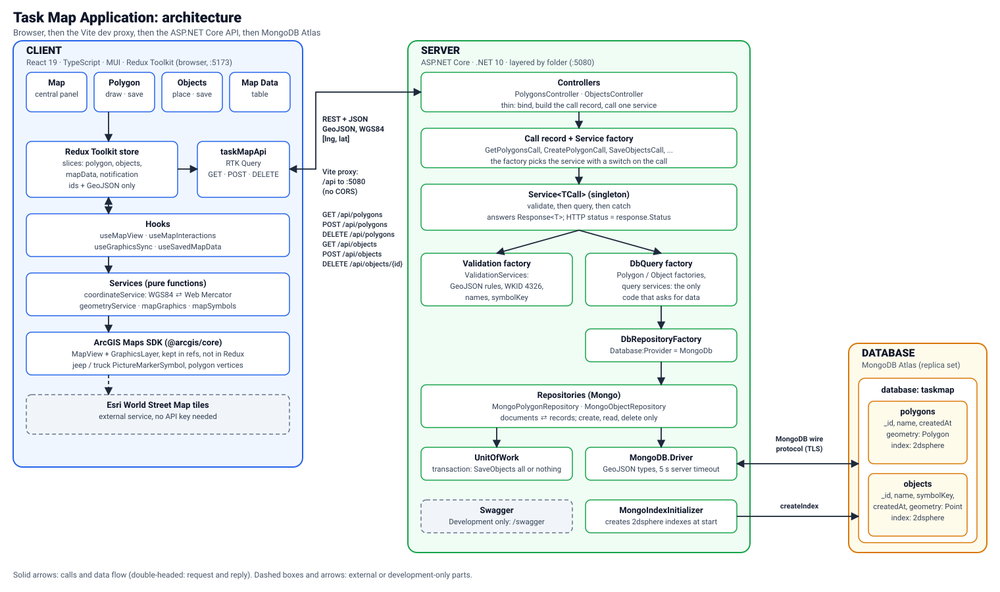

# Task Map Application

A client-server application for managing geographic objects on an interactive map: **polygons** that the user draws,
and **objects** (a jeep or a truck image) that the user places. Everything is saved to MongoDB through a REST API.

| Part | Technology | Folder |
| --- | --- | --- |
| Client | React, TypeScript, MUI, Redux Toolkit, ArcGIS Maps SDK (`@arcgis/core`) | [client/](client/README.md) |
| Server | ASP.NET Core (controllers), .NET 10 | [server/](server/src/TaskMap.Api) |
| Database | MongoDB (Atlas free tier), GeoJSON with a `2dsphere` index | [database/](database/README.md) |

## What it does

The screen has four panels: the map, **Polygon**, **Objects** and **Map Data**.

- **Polygon**: _Add_ starts drawing (click to place vertices, click the first point to close), _Save_ stores the
  polygon, _Delete_ removes the selected polygons.
- **Objects**: _Add_ places the next image (jeep, truck, jeep, ...), _Save_ stores the placed objects, _Delete_ removes
  the selected object.
- **Map Data**: a table of every saved item (Object / Lat / Lon). The Object cell shows `name`, `type` and
  `object: { geometry }` as an expandable tree. Selecting a row selects the item on the map, and the other way round.
  Ctrl + drag on the map draws a selection box.
- **Resizing**: drag the thin bar between the map and the panels to widen them (arrow keys work too, double-click resets).

## Architecture



How a **Save** travels through the system:

1. The client keeps only ids and GeoJSON in Redux. The ArcGIS `MapView` and its graphics live in hooks and refs.
   `coordinateService` converts the drawn Web Mercator points to WGS84 `[lng, lat]` before the POST.
2. In development the Vite proxy forwards `/api` to the server, so the server needs no CORS setup.
3. A thin controller builds one call record and hands it to its service. The service validates the request (GeoJSON
   rules, WKID 4326), runs the query service, and catches errors, so every reply has the same
   `{ isSuccess, status, error, result }` shape.
4. The query service reads and writes through a repository chosen by `DbRepositoryFactory`. Saving a list of
   objects runs in one MongoDB transaction, so it is stored all or nothing.
5. MongoDB stores GeoJSON with a `2dsphere` index. The server answers with the refreshed list, and the Map Data
   table shows exactly what came back.

Server layers point one way: Controllers, Services, Factories, Validation and Queries, Repositories. The details are
in [CLAUDE.md](CLAUDE.md).

## Run it

You need [.NET 10 SDK](https://dotnet.microsoft.com/download), [Node.js](https://nodejs.org/) (current LTS) and a
MongoDB database.

### 1. Database

The API needs a MongoDB connection string and does not start without one. The easiest way is a free MongoDB Atlas
cluster: [database/README.md](database/README.md) explains it step by step, with sample data in
[database/seed/](database/seed).

Give the string to the API without committing it, from `server/src/TaskMap.Api`:

```
dotnet user-secrets set "Database:MongoDb:ConnectionString" "mongodb+srv://<user>:<password>@<cluster-host>/?retryWrites=true&w=majority"
```

(or set the `Database__MongoDb__ConnectionString` environment variable). The database name is `taskmap` by default.
The API creates the two `2dsphere` indexes when it starts.

### 2. Server

```
cd server/src/TaskMap.Api
dotnet run
```

The API listens on http://localhost:5080. In Development, Swagger is at http://localhost:5080/swagger.

### 3. Client

```
cd client
npm install
npm run dev
```

Open http://localhost:5173. Requests to `/api` are proxied to the server.

The map works without an ArcGIS key (it uses Esri's public World Street Map tiles). To use the vector basemap, copy
`client/.env.example` to `client/.env.local` and set `VITE_ARCGIS_API_KEY`.

## API

| Call | Request | Returns |
| --- | --- | --- |
| `GET /api/polygons` | - | all polygons |
| `POST /api/polygons` | one polygon (name + GeoJSON) | the refreshed list |
| `DELETE /api/polygons` | `{ "ids": [...] }` | the refreshed list |
| `GET /api/objects` | - | all objects |
| `POST /api/objects` | `{ "objects": [...] }` (saved all or nothing) | the refreshed list |
| `DELETE /api/objects/{id}` | - | the refreshed list |

Every reply is `{ isSuccess, status, error, result }`, and the HTTP status equals `status`. Geometry is GeoJSON in WGS84,
positions written `[longitude, latitude]`.

## Checks

From `client/`: `npm run build` (type-checks first), `npm run lint`, `npm test`, `npm run format:check`.
From `server/`: `dotnet build` (warnings are errors).

## More documentation

- [CLAUDE.md](CLAUDE.md): architecture and conventions (server layers, factories, repositories, client structure).
- [DESIGN.md](DESIGN.md): visual rules.
- [CLIENT_QUESTIONS.md](CLIENT_QUESTIONS.md): open questions for the client.
- [database/schema.md](database/schema.md): what is stored in MongoDB.
- [docs/architecture.svg](docs/architecture.svg): the diagram above, as a standalone image.

## License

MIT, see [LICENSE](LICENSE).
